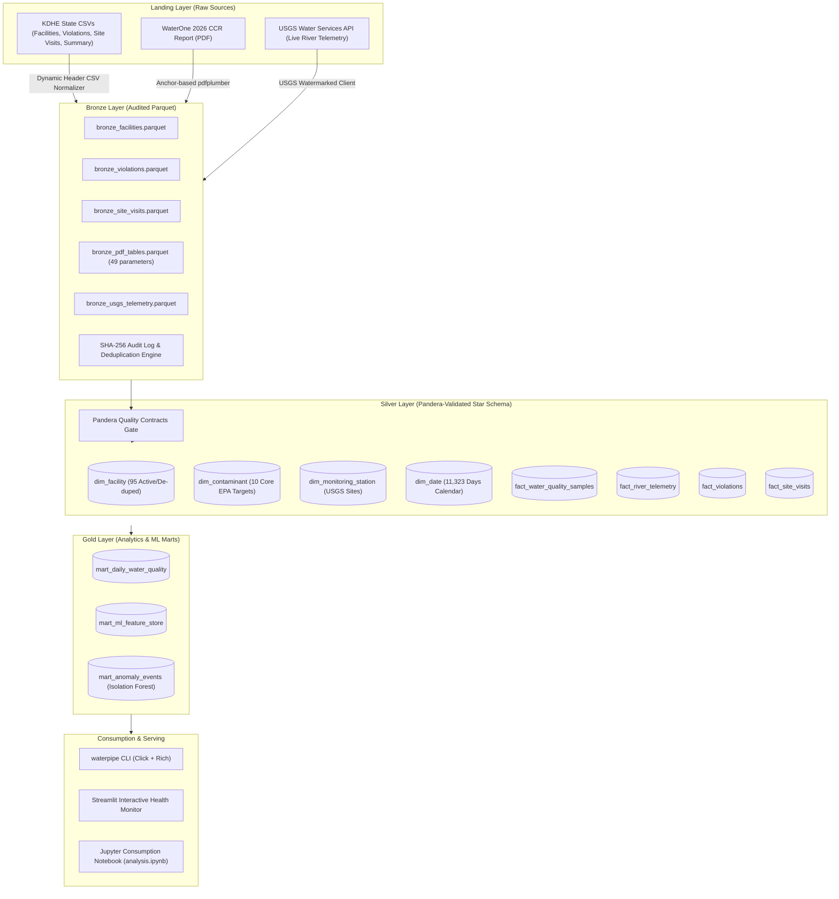

# 💧 WaterOne Data Engine (`waterone-data-engine`)

[](https://www.python.org/)
[](https://duckdb.org/)
[](https://pandera.readthedocs.io/)
[](https://streamlit.io/)
[]()

An end-to-end, zero-cost, local Medallion Architecture water quality data engineering lakehouse, telemetry engine, and pre-breach predictive health monitoring platform for **Water District No. 1 of Johnson County, Kansas (WaterOne, PWS ID: KS2009110)**.

---

## 🏛️ Lakehouse Architecture

The system implements a decoupled **Medallion Architecture** running locally on **DuckDB** and **Apache Parquet**, transitioning unstructured and multi-source telemetry into relational star schemas and ML feature marts.



---

## 🌊 River Intake Blending & Hydrologic Physics

WaterOne serves over 450,000 customers in Johnson County, KS by sourcing raw surface water from two major river basins and local collector wells.

### 1. Seasonal Source-Blending Equation
The Gold feature store combines intake waters according to WaterOne's operational capacity distribution:
$$\text{BlendedTurbidity}_t = 0.514 \cdot \text{MoRiver}_t + 0.275 \cdot \text{Wolcott}_t + 0.196 \cdot \text{KsRiver}_t + 0.016 \cdot \text{Wells}_t$$

* **Missouri River Gravity Intake**: $51.4\%$
* **Wolcott Collector Well** (Missouri River alluvium): $27.5\%$
* **Kansas River Intake**: $19.6\%$
* **Local Deep Wells**: $1.6\%$

### 2. USGS Telemetry & Sediment Rating Curves
Live hydrologic data is pulled from USGS Water Services for two major reaches:
1. **Kansas River at De Soto, KS (`06892350`)**: Streamflow ($00060$), In-situ Optical Turbidity ($63680$), Temperature ($00010$), Conductance ($00095$).
2. **Missouri River Reach**:
   - **Parkville, MO (`06893000`)**: Upstream Streamflow ($00060$).
   - **Randolph, MO (`06893060`)**: Live In-situ Optical Turbidity ($63680$) and Water Temperature ($00010$).

When upstream telemetry sensors experience transmission dropouts, turbidity is dynamically estimated from streamflow discharge ($Q$, in cfs) using empirical USGS power-law sediment rating curves:
$$\text{Turbidity} = a \cdot Q^b$$
* **Missouri River**: $a = 0.00052, \quad b = 1.08$
* **Kansas River**: $a = 0.0018, \quad b = 1.12$

---

## 🛡️ Data Quality Contracts (Pandera)

All Bronze data entering the Silver layer is strictly evaluated through Pandera type, nullability, and boundary contracts:
* `FacilitySchema`: Validates facility identifier uniqueness and activity status enum (`Active`, `Inactive`, `Proposed`).
* `RiverTelemetrySchema`: Asserts physical non-negativity ($Q \ge 0\ \text{cfs}$, $\text{Turbidity} \ge 0\ \text{FNU/NTU}$, Conductance $> 0$).
* `WaterQualitySampleSchema`: Validates analytical reporting units, numerical ranges, and compliance flags.
* All validation events and violation metrics are recorded in `silver_quality_audit` in DuckDB.

---

## 🤖 Pre-Breach ML Anomaly Detection

To alert utility operators before contaminant concentrations approach regulatory thresholds, the platform deploys an unsupervised **Isolation Forest** trained on multi-variate hydrologic features:
* `blended_turbidity_ntu` & `turbidity_7d_ma`
* `turbidity_volatility_7d` (rolling 7-day $\sigma$)
* `total_upstream_flow_cfs`
* `treatment_stress_ratio` ($\frac{\text{Raw Intake Turbidity}}{\text{Finished Baseline}}$)

### Anomaly Severity Scoring (0–100)
The model converts tree path isolation depths into a human-interpretable severity index:
* **Normal ($0-40$)**: Nominal intake conditions.
* **Pre-Breach Warning ($41-74$)**: High volatility or elevated upstream sediment loading. Early coagulation adjustment recommended.
* **Critical Alert ($\ge 75$)**: Flash runoff or extreme turbidity spike. Shift intake weighting to Wolcott collector well.

---

## 🚀 Quickstart

### 1. Prerequisites & Installation
Ensure you have Python 3.12+ and Poetry installed:
```bash
# Clone the repository
git clone https://github.com/rahul-arulkumar/waterone-data-engine.git
cd waterone-data-engine

# Install dependencies in local virtualenv
poetry install
```

### 2. Execute End-to-End Pipeline
Run the full ingestion, validation, dimensional modeling, and ML scoring DAG with one command:
```bash
poetry run waterpipe run
```

### 3. Launch the Interactive Health Monitor UI
```bash
poetry run waterpipe dashboard
```
The Streamlit dashboard opens at `http://localhost:8501`.

---

## 💻 CLI Reference (`waterpipe`)

The platform includes a CLI built with **Click** and **Rich**:

| Command | Description |
| :--- | :--- |
| `poetry run waterpipe status` | Inspect Lakehouse catalog, table row counts, and recent ingestion audit logs |
| `poetry run waterpipe ingest` | Execute Bronze extractors (PDF, KDHE CSVs, USGS Telemetry) with SHA-256 deduplication |
| `poetry run waterpipe validate` | Run Pandera quality contracts and review quality audit gates |
| `poetry run waterpipe transform`| Build Silver Star Schema (`dim_*`, `fact_*`) and Gold Feature Marts |
| `poetry run waterpipe detect` | Train Isolation Forest and compute pre-breach anomaly severity scores |
| `poetry run waterpipe run` | Execute complete end-to-end DAG (`ingest` $\rightarrow$ `validate` $\rightarrow$ `transform` $\rightarrow$ `detect`) |
| `poetry run waterpipe query "<sql>"` | Run ad-hoc vectorized SQL queries directly against the DuckDB catalog |
| `poetry run waterpipe export <mart> <fmt>` | Export Gold marts to `csv`, `json`, or `parquet` (`--dest <path>`) |
| `poetry run waterpipe dashboard` | Launch the Streamlit Interactive Water Quality Monitor UI |

### Example CLI Usages:
```bash
# Query the 5 highest severity anomaly dates
poetry run waterpipe query "SELECT date, severity_index, alert_level, primary_contributing_factor FROM mart_anomaly_events ORDER BY severity_index DESC LIMIT 5;"

# Export daily water quality mart to CSV
poetry run waterpipe export mart_daily_water_quality csv --dest exports/daily_quality.csv
```

---

## 📊 Streamlit Health Monitor (`dashboard/app.py`)

The interactive Streamlit dashboard features:
1. **Executive Health Scorecard**: Water Safety Index, Raw vs Finished Turbidity, River Flow, and Active Facilities.
2. **Pre-Breach Warning Banner**: Operator guidance, primary physical driver, and root cause attribution.
3. **Interactive Sensitivity Slider**: Real-time recalculation of Isolation Forest contamination threshold ($1\% - 15\%$).
4. **Regulatory Benchmarks & Standards**: Clean presentation of EPA Action Levels (Lead $15\ \text{ppb}$, Copper $1.3\ \text{ppm}$) vs. Primary MCLs (Fluoride, Turbidity, Disinfection Byproducts) without missing values.
5. **Upstream River Dynamics & Discharge**: Interactive time-series charts comparing Kansas vs. Missouri River flow and turbidity spikes.
6. **WaterOne Facilities & Inspection Audit**: Filterable directory of 95 active treatment plants, reservoirs, booster pump stations, and historical KDHE inspection logs.

---

## 🧪 Automated Test Suite

The project includes an automated test suite across 5 test modules covering unit, contract, and end-to-end integration tests:

```bash
poetry run pytest tests/ -v
```

```text
tests/test_feature_store_and_models.py::test_feature_store_calculations PASSED
tests/test_feature_store_and_models.py::test_ml_feature_store_structure PASSED
tests/test_feature_store_and_models.py::test_isolation_forest_anomaly_detector PASSED
tests/test_feature_store_and_models.py::test_lakehouse_gold_views PASSED
tests/test_ingestion.py::test_audit_manager_record_and_check PASSED
tests/test_ingestion.py::test_snake_case_conversion PASSED
tests/test_ingestion.py::test_csv_normalizer_kdhe_files PASSED
tests/test_ingestion.py::test_pdf_parser_ccr_extraction PASSED
tests/test_ingestion.py::test_usgs_client_telemetry PASSED
tests/test_ingestion.py::test_bronze_orchestrator_views PASSED
tests/test_pipeline_integration.py::test_pipeline_status PASSED
tests/test_pipeline_integration.py::test_pipeline_query PASSED
tests/test_pipeline_integration.py::test_pipeline_export PASSED
tests/test_pipeline_integration.py::test_cli_status PASSED
tests/test_pipeline_integration.py::test_cli_validate PASSED
tests/test_pipeline_integration.py::test_cli_detect PASSED
tests/test_pipeline_integration.py::test_cli_query PASSED
tests/test_pipeline_integration.py::test_cli_export PASSED
tests/test_quality_contracts.py::test_pandera_rejection_negative_telemetry PASSED
tests/test_quality_contracts.py::test_pandera_rejection_duplicate_facility_pk PASSED
tests/test_quality_contracts.py::test_pandera_rejection_invalid_facility_status PASSED
tests/test_quality_contracts.py::test_silver_star_schema_generation PASSED
tests/test_quality_contracts.py::test_duckdb_star_schema_joins PASSED
tests/test_scaffold.py::test_pipeline_config_loads PASSED
tests/test_scaffold.py::test_contaminant_mapping_loads PASSED
tests/test_scaffold.py::test_core_imports PASSED
============================== 26 passed in 2.3s ===============================
```

---

## 📁 Repository Structure

```text
waterone-data-engine/
├── config/
│   ├── pipeline_config.yaml           # USGS stations, landing paths, lakehouse settings
│   └── contaminant_mapping.yaml       # EPA MCLs, Action Levels, units, and warning thresholds
├── data/
│   ├── landing/                       # Dropzone for raw files (CCR 2026 PDF, KDHE CSVs)
│   ├── bronze/                        # Audited raw Parquet tables & audit log
│   ├── silver/                        # Dimensional Star Schema (dim_*, fact_*) Parquet tables
│   └── gold/                          # Daily mart, ML feature store & anomaly events
├── database/
│   └── water_lakehouse.duckdb         # Vectorized DuckDB lakehouse catalog
├── dashboard/
│   └── app.py                         # Streamlit Water Quality Health Monitor UI
├── notebooks/
│   └── analysis.ipynb                 # Analytical consumption notebook reading from Gold Marts
├── src/
│   ├── cli.py                         # waterpipe CLI entrypoint
│   ├── pipeline.py                    # End-to-end DAG orchestrator
│   ├── ingestion/
│   │   ├── audit.py                   # SHA-256 fingerprinting & audit manager
│   │   ├── csv_normalizer.py          # Dynamic header-detecting CSV parser
│   │   ├── pdf_parser.py              # Dynamic anchor-based CCR PDF extractor
│   │   ├── usgs_client.py             # Watermarked USGS river telemetry client
│   │   └── orchestrator.py            # Bronze ingestion runner
│   ├── quality/
│   │   └── contracts.py               # Pandera schema contracts & validation gates
│   ├── transformation/
│   │   ├── dimensional_models.py      # Silver Star Schema builder
│   │   └── feature_store.py           # Gold seasonal blending & rolling feature store
│   └── models/
│       └── anomaly_detector.py        # Scikit-Learn Isolation Forest pre-breach detector
├── tests/                             # 26 automated unit and integration tests
├── pyproject.toml                     # Poetry dependency definitions & CLI script bindings
└── README.md                          # Comprehensive project documentation
```

---

## 📜 License
This project is licensed under the MIT License - see the [LICENSE](file:///Users/rahula/Documents/waterone-data-engine/LICENSE) file for details.
